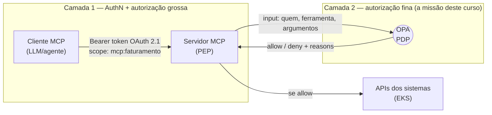

# Capítulo 1 — OPA: o modelo de decisão e o caso dos MCPs

> A empresa está construindo MCPs que se conectam a sistemas no EKS via API, e a pergunta que aparece em toda reunião de design é: **"quem pode chamar o quê?"**. Neste capítulo entendemos o problema de autorização em MCPs, o modelo de decisão do OPA (política + dados + entrada) e onde ele senta na arquitetura. No fim, você roda sua primeira avaliação de política — sem ainda escrever Rego.

## 🎯 Objetivos

- Explicar o problema que o **OPA** resolve e o que é *policy as code*;
- Definir os papéis **PEP**, **PDP** e **PIP** — vocabulário usado no resto do curso;
- Entender o modelo de decisão: `decisão = política (Rego) + dados + entrada (input)`;
- Explicar **por que scopes OAuth 2.1 não bastam** para autorizar chamadas de ferramenta em MCPs;
- Desenhar a arquitetura alvo: MCP → OPA → APIs no EKS;
- Instalar o binário `opa` e executar a primeira avaliação (`opa eval`).

## 📖 Conteúdo

### 1.1 O problema: autorização espalhada pelo código

Sem um mecanismo central, toda permissão vira código dentro de cada serviço:

```python
# dentro de cada MCP / API... para sempre
if user.team == "faturamento" and tool == "emitir_reembolso" and amount < 500:
    ...
elif user.role == "admin":
    ...
```

Isso tem problemas conhecidos ([docs do OPA — motivação](https://openpolicyagent.org/docs/latest/#why-opa)):

- **Regra duplicada** — a mesma lógica é reimplementada (e diverge) em cada serviço/linguagem;
- **Mudança lenta** — mudar uma regra exige redeploiamento de aplicação;
- **Sem auditoria unificada** — nenhuma resposta única para "por que este acesso foi negado ontem?";
- **Regra invisível** — a política não está versionada nem revisável como código.

O OPA (*Open Policy Agent*, projeto **graduated da CNCF**) externaliza a política: a aplicação pergunta a um **motor de decisão** e apenas **obedece à resposta**. A política vira um artefato versionado, testável e auditável — *policy as code*.

### 1.2 O vocabulário: PEP, PDP, PIP

O OPA usa o vocabulário clássico de autorização ([NIST ABAC](https://csrc.nist.gov/projects/attribute-based-access-control)):

| Termo | Papel | No nosso caso |
|---|---|---|
| **PEP** — Policy *Enforcement* Point | Onde a decisão é **aplicada** (bloqueia/deixa passar) | O **servidor MCP** (ou o gateway na frente dele) |
| **PDP** — Policy *Decision* Point | Onde a decisão é **calculada** | O **OPA** |
| **PIP** — Policy *Information* Point | De onde vêm os **dados** para decidir | Base de papéis/permissões, claims do JWT, catálogo de recursos |

> ⚠️ **Ponto que evita confusão futura:** o OPA **nunca aplica** a decisão. Ele *responde* `allow: true/false` — quem bloqueia a chamada é o PEP (seu MCP). Se o PEP ignorar a resposta, nada acontece. Guardamos isso para o capítulo 6.

### 1.3 O modelo de decisão do OPA

Tudo que o OPA faz é avaliar uma **query** contra três coisas ([docs — policy language](https://openpolicyagent.org/docs/policy-language)):

```mermaid
flowchart LR
    IN["Entrada (input)<br/>a requisição/ferramenta + quem chamou"] --> DEC(("OPA (PDP)<br/>avalia Rego"))
    POL["Política (Rego)<br/>AS REGRAS — em Git"] --> DEC
    DATA["Dados (data)<br/>papéis, permissões, catálogo"] --> DEC
    DEC --> OUT["Decisão<br/>{&quot;allow&quot;: true} / {&quot;allow&quot;: false, &quot;reasons&quot;: [...]}"}
```

- **Política (Rego)** — o *como decidir*. Arquivo `.rego`, versionado em Git, atualizado sem redeploy da aplicação;
- **Dados (`data`)** — o *universo*: quem tem qual papel, quais projetos existem, limites por ambiente. Carregados no OPA (via bundle);
- **Entrada (`input`)** — o *caso concreto*: esta chamada, este usuário, estes argumentos. Fornecida pelo PEP a cada consulta;
- **Decisão** — um documento JSON qualquer. Por convenção, uma regra booleana `allow` (e opcionalmente `reasons`).

> 💡 A separação **política × dados** é o que permite mudar "quem é admin" (dado) sem tocar em "como se decide" (política) — e vice-versa.

### 1.4 Por que MCPs precisam de mais que OAuth

A especificação do MCP define autorização com **OAuth 2.1** ([spec de authorization do MCP](https://modelcontextprotocol.io/docs/2026-07-28/tutorials/security/authorization)): o servidor MCP é um *resource server* OAuth, o cliente MCP apresenta um *bearer token*. Isso resolve a **autenticação** (*quem é você*) e uma autorização **grossa** (*este token cobre ferramentas de faturamento*).

Mas scopes são insuficientes para autorização fina — resumo do argumento de [p0.dev sobre MCP](https://p0.dev/blog/oauth-scopes-dont-equal-secure-mcp-authorization):

| Limitação do scope | Consequência prática no MCP |
|---|---|
| **Token estático** — congela permissões até expirar | Usuário rebaixado continua com acesso até o token morrer |
| **Sem contexto** — não sabe *qual projeto/recurso/valor* | Dois usuários com `faturamento:ler` — um só pode ver o próprio projeto — são indistinguíveis |
| **Scope sprawl** — 1 scope por ferramenta vira inchaço | JWT gigante e frágil, nova scope para cada ferramenta nova |
| **Sem sequência** — cada chamada avaliada isolada | Agente encadeia ferramentas "inofensivas" até efeito privilegiado |

A recomendação da indústria (p0.dev, [Solo.io](https://www.solo.io/blog/mcp-authorization-is-a-non-starter-for-enterprise), [Red Hat](https://www.redhat.com/en/blog/mcp-security-implementing-robust-authentication-and-authorization)) é **híbrida**:



1. **Token** valida identidade e o domínio amplo (scopes pequenos e estáveis);
2. **OPA** decide **por chamada de ferramenta**: identidade + papel + projeto + argumentos (incluindo *valores* — ex.: reembolso ≤ R$ 500) no momento do request.

### 1.5 Onde o OPA roda (visão geral — detalhes no capítulo 5)

Para MCPs no EKS, os padrões oficiais ([docs — deploy no K8s](https://openpolicyagent.org/docs/deploy/k8s)) se traduzem assim:

| Padrão | Como fica | Quando escolher |
|---|---|---|
| **Sidecar** | OPA junto de cada pod de MCP, consultado via `localhost:8181` | Latência mínima; cada MCP com política própria |
| **Serviço centralizado** | Deployment OPA (3 réplicas) + Service, compartilhado por todos os MCPs | Muitos MCPs, política comum, dados grandes |
| **opa-envoy (ext_authz)** | Envoy/gateway chama OPA antes de qualquer request chegar ao MCP | Enforcement na malha/API gateway |

Este curso constrói com **sidecar** e mostra o **centralizado** — os dois cobrem ~100% dos casos de MCP.

### 1.6 Instalando o `opa` e a primeira avaliação

Instale o binário ([releases oficiais](https://github.com/open-policy-agent/opa/releases)):

```bash
# macOS / Linux (brew)
brew install opa
# ou baixe o binário direto do GitHub releases e coloque no PATH
opa version
```

Salve este arquivo como `primeira.rego` (não se preocupe com a sintaxe agora — é o capítulo 2):

```rego
package curso.opa

import rego.v1

permitir if {
    input.usuario == "ana"
    input.acao == "listar_faturas"
}
```

E este `input.json`:

```json
{
  "usuario": "ana",
  "acao": "listar_faturas"
}
```

Avalie:

```bash
opa eval --data primeira.rego --input input.json 'data.curso.opa.permitir'
```

Saída:

```json
{
  "result": [
    {
      "expressions": [
        {
          "value": true,
          "text": "data.curso.opa.permitir",
          "location": {
            "row": 1,
            "col": 1
          }
        }
      ]
    }
  ]
}
```

Você acabou de executar o ciclo completo: **política + entrada → decisão**, sem servidor, sem cluster. Os capítulos 2 e 3 constroem políticas reais sobre este ciclo.

> 💡 Para respostas limpas: `opa eval --format=json ... | jq '.result[0].expressions[0].value'` → `true`.

## 🧪 Laboratório 1 — Verifique seu entendimento

1. Instale o `opa` e confirme `opa version`;
2. Rode o exemplo da seção 1.6 e obtenha `true`;
3. **Provocação (mude o input):** troque `"acao"` para `"emitir_reembolso"` e reavalie. O resultado é `false` — e note que a saída não tem `"result"` com valor `false`; simplesmente **não há resultado**. Guarde essa estranheza: é a **negação por falha** do Rego, tema central do capítulo 2;
4. **Responda (sem reler):** na arquitetura da sua empresa, quem é o PEP, quem é o PDP e quem é o PIP?

Verificação: se você acertou que *o servidor MCP é o PEP, o OPA é o PDP e a base de papéis/claims é o PIP*, o capítulo cumpriu seu papel.

## Próximos passos

- **[Capítulo 2 — Rego do zero](cap-02-rego-fundamentos.md):** a linguagem em que as políticas são escritas: rules, unificação, negação por falha e o padrão `default deny := false`;
- Dúvidas sobre este capítulo? Pergunte ao seu agente — ele é o professor do curso.
