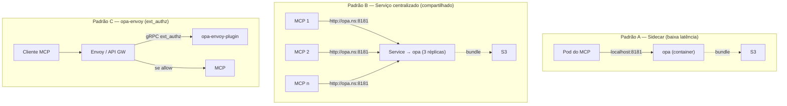

# Capítulo 5 — Deploy do OPA no EKS

> O OPA do laboratório agora precisa viver no cluster onde os MCPs rodam. Este capítulo traduz os padrões oficiais de deploy do OPA em Kubernetes ([docs](https://openpolicyagent.org/docs/deploy/k8s)) para o **EKS**: sidecar colado em cada MCP, ou serviço centralizado compartilhado; bundles servidos do **S3** com **EKS Pod Identity** (pressuposto: você já conhece Pod Identity/IRSA); probes, HPA e hardening de rede.

## 🎯 Objetivos

- Escolher entre **sidecar**, **serviço centralizado** e **opa-envoy** com critérios técnicos;
- Deployar o OPA como **Deployment + Service** no EKS com config via Secret;
- Servir bundles do **S3** com autenticação SigV4 via **EKS Pod Identity**;
- Aplicar o hardening oficial: QoS, probes, anti-afinidade, HPA;
- Fechar a rede do OPA (NetworkPolicy) e proteger a API de decisão.

## 📖 Conteúdo

### 5.1 Os três padrões (e o critério de escolha)



| Critério | A — Sidecar | B — Centralizado | C — opa-envoy |
|---|---|---|---|
| Latência | **localhost** (~µs) | hop de rede (~ms) | hop (no data path do gateway) |
| Recursos | 1 OPA por pod de MCP (multiplica memória) | 3 réplicas atendem todos | 1 por gateway |
| Política | Pode ser **por MCP** (bundle diferente) | **Comum** a todos os PEPs | Comum ao domínio do gateway |
| Atualização de política | bundle por pod (todos pull do S3) | 1 lugar | bundle por instância |
| Falha | Contida no pod | **dependência central** (mitigar com réplicas) | no gateway |
| Acoplamento ao código | O MCP chama OPA explicitamente | Idem | **Zero** (o app nem sabe) |

**Guia de decisão para o caso dos MCPs:**

- Poucos MCPs, política por MCP, latência crítica → **A (sidecar)** — padrão preferido das docs para apps;
- Muitos MCPs com a mesma política/organização, dados de RBAC grandes → **B (centralizado)**;
- Já existe gateway/malha (Envoy, Istio, APP Mesh deprecado…) na frente dos MCPs → **C**.
  
Este capítulo implementa **A e B** (C fica como referência — [opa-envoy-plugin](https://github.com/open-policy-agent/opa-envoy-plugin)).

### 5.2 Preparando o bundle no S3

O pipeline de política (CI completo no capítulo 7, versão mínima aqui):

```bash
# 1. build do bundle (política + dados)
opa build -b bundle/ -r "v$(date +%Y%m%d-%H%M)" -o mcp-bundle.tar.gz
#    -r grava a "revision" no manifest — aparece nos decision logs!

# 2. upload para o S3 (bucket privado, versionado)
aws s3 cp mcp-bundle.tar.gz s3://empresa-opa-bundles/mcp/bundle.tar.gz
```

O OPA consulta o objeto periodicamente (`poll`); quando o `revision` muda, ele troca a política ativa. O S3 já responde `304 Not Modified` quando nada mudou — o polling é barato.

### 5.3 IAM: EKS Pod Identity para o OPA ler o S3

O OPA assina as chamadas ao S3 com **SigV4** — basta dar credenciais AWS ao pod ([docs — S3 bundles + SigV4](https://www.openpolicyagent.org/docs/configuration.html)). Semântica idêntica à que você já usou com Pod Identity/IRSA:

```bash
# 1. política IAM mínima (leitura do prefixo do bundle)
aws iam create-policy --policy-name OpaBundleReader \
  --policy-document '{
    "Version": "2012-10-17",
    "Statement": [{
      "Effect": "Allow",
      "Action": ["s3:GetObject"],
      "Resource": "arn:aws:s3:::empresa-opa-bundles/mcp/*"
    }]
  }'

# 2. associação via EKS Pod Identity (service account opa no namespace mcp-platform)
eksctl create pod-identity-association \
  --cluster lab-opa --namespace mcp-platform --service-account opa \
  --policy-arn arn:aws:iam::123456789012:policy/OpaBundleReader
```

O OPA resolve as credenciais automaticamente pela cadeia padrão do SDK (web identity do Pod Identity) — sem segredos em Secrets.

### 5.4 O `config.yaml` para o S3

```yaml
# opa-config.yaml — Secret montado no pod
bundles:
  mcp:
    service: s3-bundles
    resource: mcp/bundle.tar.gz          # caminho do objeto (relativo à URL base)
    poll:
      min_delay_seconds: 30
      max_delay_seconds: 120
    signing:
      method: aws4-signing              # SigV4 nativo do plugin bundle
      provider: aws                     # usa a cadeia de credenciais do pod

services:
  s3-bundles:
    url: https://empresa-opa-bundles.s3.us-east-1.amazonaws.com

decision_logs:
  console: true                         # stdout → CloudWatch ( Fluent Bit/Container Insights)

status:
  console: true                         # saúde do bundle no stdout também
```

> 💡 **Revision nos logs:** sempre passe `-r <revisão>` no `opa build`. Cada decision log passa a carregar a revision da política que decidiu — indispensable para auditoria e debug ("aquela negação usava a política v42").

### 5.5 Padrão B — Serviço centralizado (manifests)

Manifests completos em [`exemplos/k8s/opa-centralizado.yaml`](../exemplos/k8s/opa-centralizado.yaml); os pontos estruturais:

```yaml
apiVersion: v1
kind: Secret                            # 1. config via Secret, como nas docs
metadata:
  name: opa-config
  namespace: mcp-platform
stringData:
  opa-config.yaml: |
    bundles:
      mcp:
        service: s3-bundles
        resource: mcp/bundle.tar.gz
        poll: { min_delay_seconds: 30, max_delay_seconds: 120 }
        signing: { method: aws4-signing, provider: aws }
    services:
      s3-bundles:
        url: https://empresa-opa-bundles.s3.us-east-1.amazonaws.com
    decision_logs:
      console: true
---
apiVersion: apps/v1
kind: Deployment
metadata:
  name: opa
  namespace: mcp-platform
spec:
  replicas: 3
  selector: { matchLabels: { app: opa } }
  template:
    metadata:
      labels: { app: opa }
    spec:
      serviceAccountName: opa           # Pod Identity
      containers:
        - name: opa
          image: openpolicyagent/opa:latest-static-debug   # fixe a tag da versão no seu ambiente
          args:
            - run
            - --server
            - --config-file=/run/secrets/opa/opa-config.yaml
            - --addr=0.0.0.0:8181
            - --log-level=info
          ports: [{ containerPort: 8181 }]
          readinessProbe:               # pronto = bundle ativo (não só processo vivo)
            httpGet: { path: /health/live, port: 8181 }
          livenessProbe:
            httpGet: { path: /health/live, port: 8181 }
          resources:                    # QoS Guaranteed (recomendação das docs)
            requests: { cpu: "1", memory: 1Gi }
            limits: { cpu: "1", memory: 1Gi }
      affinity:                         # espalhar réplicas por nós
        podAntiAffinity:
          preferredDuringSchedulingIgnoredDuringExecution:
            - weight: 100
              podAffinityTerm:
                labelSelector: { matchLabels: { app: opa } }
                topologyKey: kubernetes.io/hostname
---
apiVersion: v1
kind: Service
metadata:
  name: opa
  namespace: mcp-platform
spec:
  selector: { app: opa }
  ports: [{ port: 8181, targetPort: 8181 }]
```

Aplicando e testando:

```bash
kubectl create namespace mcp-platform
kubectl apply -f exemplos/k8s/opa-centralizado.yaml
kubectl -n mcp-platform rollout status deploy/opa

# health/readiness inclui o estado do bundle:
kubectl -n mcp-platform exec deploy/opa -- curl -s localhost:8181/health | jq

# decisão de verdade, de dentro do cluster:
kubectl run curl-test --rm -it --image=curlimages/curl --restart=Never -- \
  curl -s -X POST http://opa.mcp-platform.svc.cluster.local:8181/v1/data/mcp/autorizacao/decisao \
  -H 'Content-Type: application/json' -d @- <<< '{"input": {"claims": {"sub": "ana@empresa.com"}, "chamada": {"ferramenta": "listar_faturas", "argumentos": {"projeto_id": "proj-41"}}, "contexto": {"ambiente": "prod"}}}' | jq .result
```

### 5.6 Padrão A — Sidecar no pod do MCP

Mesma config, outro lugar. O exemplo completo em [`exemplos/k8s/mcp-com-sidecar.yaml`](../exemplos/k8s/mcp-com-sidecar.yaml):

```yaml
# dentro do Pod do servidor MCP:
spec:
  serviceAccountName: opa              # o sidecar puxa o bundle do S3
  containers:
    - name: mcp-server
      image: empresa/mcp-faturamento:1.0
      env:
        - name: OPA_URL                # o app chama localhost — sem hop de rede
          value: http://127.0.0.1:8181
    - name: opa
      image: openpolicyagent/opa:latest-static-debug
      args: ["run", "--server", "--addr=127.0.0.1:8181",
             "--config-file=/run/secrets/opa/opa-config.yaml"]
      volumeMounts:
        - { name: opa-config, mountPath: /run/secrets/opa }
  volumes:
    - name: opa-config
      secret: { secretName: opa-config }
```

Diferenciais do sidecar: `--addr=127.0.0.1` (ninguém fora do pod alcança) e o MCP chama via `localhost` — a falha do OPA fica **contida no pod** (o MCP decide falhar a chamada — fail-closed, capítulo 7).

### 5.7 Hardening de rede (Padrão B)

O OPA é uma autoridade de decisões — trate a API dele como **interna**:

```yaml
# NetworkPolicy: só pods do namespace mcp-platform falam com o OPA
apiVersion: networking.k8s.io/v1
kind: NetworkPolicy
metadata:
  name: allow-to-opa
  namespace: mcp-platform
spec:
  podSelector: { matchLabels: { app: opa } }
  ingress:
    - from:
        - namespaceSelector: {}          # ajuste: só namespaces de MCPs
      ports: [{ port: 8181, protocol: TCP }]
```

Checklist adicional:

- ❌ **Nunca** exponha o OPA por LoadBalancer/Ingress público — quem decide é chamador interno;
- 🔒 Para o padrão B entre namespaces, considere **mTLS** (`--tls-cert-file/--tls-private-key-file` ou mtls nativo do OPA);
- 🔑 O endpoint `/v1/policies` (upload de política) deve ficar restrito — em produção, desabilite a API de escrita (`--set=services` apenas; policy entra **só** por bundle).

## 🧪 Laboratório 5 — OPA tomando decisões no EKS

1. Crie o bucket `empresa-opa-bundles` (ou um seu), faça build + upload do bundle do laboratório 4;
2. Crie a política IAM + pod-identity-association (seção 5.3) e o namespace `mcp-platform`;
3. Aplique `opa-centralizado.yaml` (ajuste URL do S3 e região) e valide: rollout ok → `/health` com bundle ativo → decisão via pod `curl-test`;
4. **Atualização quente no cluster:** mude o limite do `data.json`, rebuild, upload — espere ≤2min e refaça a mesma chamada: nova decisão com o **mesmo pod**;
5. Confira o decision log no CloudWatch (log group do cluster, stream do pod `opa`);
6. **Desafio:** replique o padrão A com o manifest `mcp-com-sidecar.yaml` (use qualquer imagem sua como MCP de mentira) e prove que o OPA responde **só** dentro do pod (`kubectl exec` de outro pod → timeout).

## Próximos passos

- **[Capítulo 6 — Projeto final](cap-06-projeto-mcp-opa.md):** o PEP em código: servidor MCP validando OAuth 2.1 e consultando o OPA a cada chamada de ferramenta — no EKS, ponta a ponta;
- Problemas no Pod Identity/S3? A mensagem do OPA (`bundle download failed`) + `kubectl logs deploy/opa` dizem quase tudo — se travar, chame o agente.

## 📚 Fontes

- [OPA — Deploy no Kubernetes (padrões oficiais)](https://openpolicyagent.org/docs/deploy/k8s)
- [OPA — Configuration Reference (bundles SigV4/S3)](https://www.openpolicyagent.org/docs/configuration.html)
- [opa-envoy-plugin (GitHub)](https://github.com/open-policy-agent/opa-envoy-plugin)
- [AWS — EKS Pod Identity (docs)](https://docs.aws.amazon.com/eks/latest/userguide/pod-identities.html)
