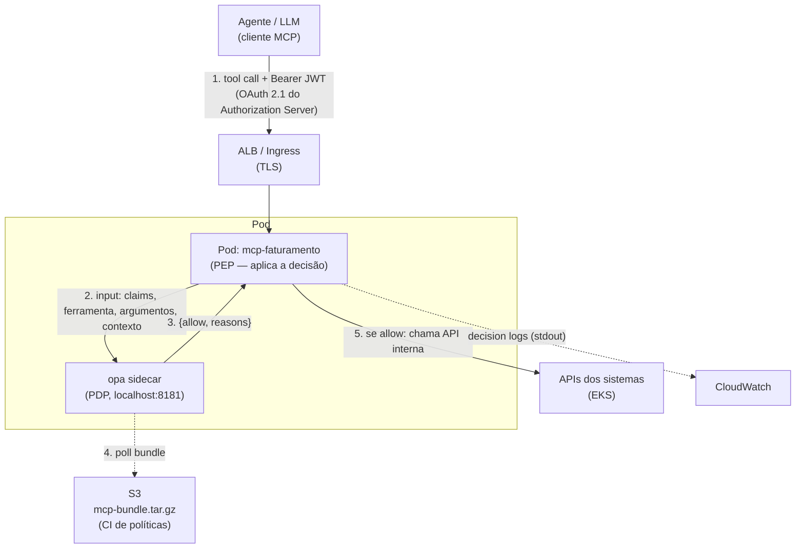

# Capítulo 6 — Projeto final: MCP + OAuth 2.1 + OPA no EKS

> Tudo converge: um **servidor MCP de faturamento** no EKS, com autenticação OAuth 2.1 (a spec do MCP), autorização fina por ferramenta via OPA (sidecar), decision logs no CloudWatch e política versionada no S3. Este capítulo monta a arquitetura completa, implementa o **PEP dentro do servidor MCP** e roda o laboratório ponta a ponta — o desenho que a empresa precisa replicar.

## 🎯 Objetivos

- Situar o **MCP**: protocolo, ferramentas (*tools*), transports e a spec de autorização (OAuth 2.1);
- Implementar o **PEP**: interceptar cada chamada de ferramenta, montar o `input`, consultar o OPA e **aplicar** a decisão (fail-closed);
- Montar a arquitetura de referência no EKS com todos os componentes do curso;
- Executar o laboratório ponta a ponta: cliente → MCP → OPA → API interna;
- Sair com o checklist para replicar o desenho na empresa.

## 📖 Conteúdo

### 6.1 MCP em 2 minutos (o que importa para autorização)

O **Model Context Protocol** ([modelcontextprotocol.io](https://modelcontextprotocol.io)) é o protocolo aberto (iniciado pela Anthropic, hoje ecossistema aberto) que conecta aplicações de IA — clientes MCP como Claude, IDEs, agentes — a **servidores MCP** que expõem capacidades:

| Primitiva | O que é | Exemplo no nosso MCP de faturamento |
|---|---|---|
| **Tools** | Funções que o modelo pode *invocar* (com argumentos!) | `listar_faturas`, `emitir_reembolso` |
| **Resources** | Dados que o modelo pode *ler* | `fatura://proj-41/2026-09` |
| **Prompts** | Templates reutilizáveis | "relatório de reembolsos do mês" |

Transports: **stdio** (local) e **HTTP** (*Streamable HTTP* — o que roda em clusters). Como *tools levam argumentos escolhidos pelo agente/LLM*, o servidor MCP é o ponto onde **toda** intenção vira uma chamada concreta — e por isso é o PEP ideal.

A spec de autorização do MCP ([docs oficiais](https://modelcontextprotocol.io/docs/2026-07-28/tutorials/security/authorization)) define o servidor MCP como **Resource Server OAuth 2.1**: clientes apresentam *access tokens* (JWT). Isso resolve **autenticação**. A autorização fina — *esta ferramenta, estes argumentos, este usuário, agora* — é **fora do escopo da spec**, e é exatamente o buraco que o OPA preenche (argumento do capítulo 1, agora implementado).

### 6.2 Arquitetura de referência



Fluxo numerado:

1. O cliente MCP apresenta o JWT (OAuth 2.1). O servidor valida assinatura/expiração/audience — middleware padrão;
2. Antes de executar a ferramenta, o PEP monta o `input` (claims + ferramenta + argumentos + contexto) e consulta o OPA **local**;
3. O OPA responde `{allow, reasons}` com base na política do bundle;
4. Política/dados chegam ao sidecar por polling do S3 — sem redeploy;
5. **Só se `allow`** o MCP chama a API interna; `deny` vira resposta de erro com o `reason`.

### 6.3 O PEP em código (a parte que a empresa escreve)

Servidor MCP em Python com o SDK oficial (`pip install "mcp[cli]"`), ferramentas protegidas por OPA. Código completo em [`exemplos/mcp/`](../exemplos/mcp/); o coração:

```python
# servidor.py — MCP de faturamento com PEP via OPA
import os, httpx
from mcp.server.fastmcp import FastMCP

OPA_URL = os.environ.get("OPA_URL", "http://127.0.0.1:8181")
AMBIENTE = os.environ.get("AMBIENTE", "dev")

mcp = FastMCP("faturamento")

def autorizar(claims: dict, ferramenta: str, argumentos: dict) -> dict:
    """PEP: consulta o PDP e aplica fail-closed."""
    input_ = {
        "claims": claims,
        "chamada": {"ferramenta": ferramenta, "argumentos": argumentos},
        "contexto": {"origem": "mcp-faturamento", "ambiente": AMBIENTE},
    }
    try:
        resp = httpx.post(
            f"{OPA_URL}/v1/data/mcp/autorizacao/decisao",
            json={"input": input_}, timeout=2.0,
        )
        resp.raise_for_status()
        decisao = resp.json().get("result", {"allow": False, "reasons": ["opa_sem_resposta"]})
    except httpx.HTTPError:
        # FAIL-CLOSED: sem OPA, sem acesso.
        decisao = {"allow": False, "reasons": ["opa_indisponivel"]}
    if not decisao.get("allow", False):
        raise PermissionError(f"negado: {decisao.get('reasons')}")
    return decisao

@mcp.tool()
def listar_faturas(projeto_id: str, claims: dict = Depends(claims_do_jwt)) -> list[dict]:
    """Lista faturas de um projeto. Requer: vínculo com a equipe do projeto."""
    autorizar(claims, "listar_faturas", {"projeto_id": projeto_id})
    return api_interna.get(f"/projetos/{projeto_id}/faturas")

@mcp.tool()
def emitir_reembolso(projeto_id: str, valor: float, motivo: str, claims: dict = Depends(claims_do_jwt)) -> dict:
    """Emite reembolso. Limites por ambiente no bundle (dev:100, prod:500)."""
    autorizar(claims, "emitir_reembolso",
              {"projeto_id": projeto_id, "valor": valor, "motivo": motivo})
    return api_interna.post("/reembolsos", {...})
```

> ⚠️ O trecho `Depends(claims_do_jwt)` é ilustrativo — no código real as claims vêm do middleware OAuth do framework HTTP que hospeda o transporte Streamable HTTP (ex.: FastAPI/Starlette). O que **não** é ilustrativo: (1) **toda** ferramenta chama `autorizar` como primeira linha; (2) o `except` é **fail-closed**; (3) os `reasons` viajam para a resposta e para o log.

**Padrões que fazem o PEP correto:**

| Padrão | Por quê |
|---|---|
| Uma função `autorizar()` única | Nenhuma ferramenta "esquece" o check; mudança de contrato num lugar só |
| Timeout curto (1–2s) + fail-closed | OPA fora do ar = nenhuma chamada passa (capítulo 7 discute o trade-off) |
| Nunca confiar em claims do cliente | Claims vêm do **token validado**, não de parâmetros do agente |
| Argumentos validados ANTES do OPA | Garanta tipos/limites de sanidade; o OPA decide **política** |

### 6.4 A política (revisão do que você já escreveu)

A política do bundle é a do laboratório 3, agora com `token_invalido` formalizado — [`exemplos/policies/mcp_autorizacao.rego`](../exemplos/policies/mcp_autorizacao.rego). Decisão completa:

```rego
package mcp.autorizacao

import rego.v1

default decisao := {"allow": false, "reasons": ["sem_regra"]}

decisao := {"allow": true, "reasons": []} if {
    claims_validas
    rbac_ok
    projeto_ok
    limite_ok
}

decisao := {"allow": false, "reasons": ["token_invalido"]} if {
    not claims_validas
}
# ... rules para rbac_negado, projeto_negado, limite_excedido
```

Matriz resultante (testada no laboratório):

| Chamada | Quem | Resultado |
|---|---|---|
| `listar_faturas` proj-41 | ana (financeiro, dona) | ✅ allow |
| `emitir_reembolso` R$600 prod | ana | ❌ `limite_excedido` |
| `listar_faturas` proj-41 | bruno (engenharia) | ❌ `rbac_negado` |
| `emitir_reembolso` R$450 proj-99 | ana | ❌ `projeto_negado` |

### 6.5 Checklist de replicação na empresa

- [ ] **Contrato do `input`** documentado (claims + chamada + contexto) — versão entre times de plataforma e de produto;
- [ ] **Bundle pipeline**: repo de políticas → PR + `opa test` no CI → `opa build` → S3 (capítulo 7);
- [ ] **Authorization Server** OAuth 2.1 emitindo JWT com `sub`, `scope` e claims de equipe (Cognito/IAM Identity Center/Keycloak — o que a empresa já tem);
- [ ] **PEP** no servidor MCP (função `autorizar` + middleware de token) — fail-closed;
- [ ] **OPA** sidecar (ou centralizado) com config apontando ao S3 + Pod Identity;
- [ ] **Observabilidade**: decision logs → CloudWatch; métricas Prometheus (capítulo 7);
- [ ] **Testes de política** cobrindo a matriz de decisão (a tabela acima é o começo).

## 🧪 Laboratório 6 — Ponta a ponta

**Parte local (sem cluster, 15min):**

1. Suba o OPA com o bundle do curso: `opa run --server --config-file exemplos/opa-config-local.yaml`;
2. Rode o servidor MCP de exemplo com `OPA_URL=http://127.0.0.1:8181` (`exemplos/mcp/servidor.py`);
3. Simule as 4 chamadas da matriz (o repositório traz um `cliente_teste.py` que injeta claims) e confirme resultados + decision logs;
4. **Quebre de propósito:** pare o OPA e tente uma chamada → `opa_indisponivel`. Fail-closed provado.

**Parte EKS (usa o laboratório 5):**

5. Containerize o MCP (Dockerfile em `exemplos/mcp/`), aplique [`exemplos/k8s/mcp-com-sidecar.yaml`](../exemplos/k8s/mcp-com-sidecar.yaml);
6. Exponha via ALB interno (mesmo padrão de ALB Ingress que você já conhece de EKS);
7. Chame de um pod qualquer com um JWT **real** do seu Authorization Server de lab;
8. Mude o limite no bundle (rebuild + upload) e veja a decisão virar **sem redeploy**;
9. **Verificação final:** no CloudWatch, encontre o decision log da chamada do passo 7 com a `revision` do bundle e o `reason` esperado.

## Próximos passos

- **[Capítulo 7 — Operação](cap-07-operacao.md):** o pipeline de CI de políticas, métricas Prometheus, o debate fail-open × fail-closed e o checklist de produção;
- Vai implementar o PEP na linguagem da empresa (Go/Node/Java)? Peça ao agente a versão do `autorizar()` — o padrão é o mesmo, só muda o HTTP client.

## 📚 Fontes

- [MCP — spec e docs oficiais](https://modelcontextprotocol.io)
- [MCP — Authorization (tutorial oficial de segurança)](https://modelcontextprotocol.io/docs/2026-07-28/tutorials/security/authorization)
- [Red Hat — MCP Security: Authentication & Authorization](https://www.redhat.com/en/blog/mcp-security-implementing-robust-authentication-and-authorization)
- [Solo.io — MCP Authorization is a Non-Starter for Enterprise](https://www.solo.io/blog/mcp-authorization-is-a-non-starter-for-enterprise)
- [p0.dev — OAuth scopes don't equal secure MCP authorization](https://p0.dev/blog/oauth-scopes-dont-equal-secure-mcp-authorization)
- [OPA — Deploy no Kubernetes](https://openpolicyagent.org/docs/deploy/k8s)
