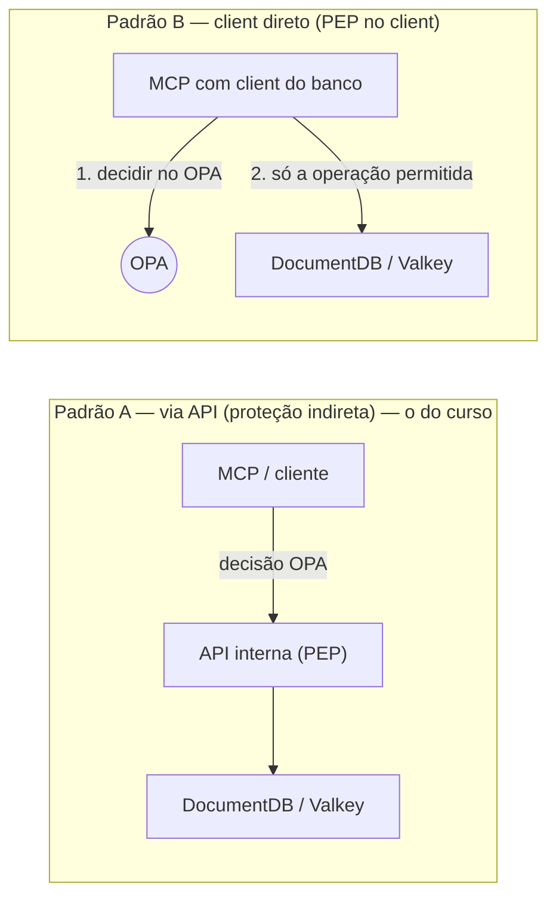

# Capítulo 8 — OPA e bancos de dados: DocumentDB e Valkey

> Uma pergunta natural depois do projeto final: *"e os bancos? O OPA protege o DocumentDB e o Valkey, ou fica só nas APIs?"*. A resposta curta: o OPA protege **o caminho até o banco** — porque DocumentDB e Valkey não têm hook de política externa. A resposta longa — com um superpoder novo (**data filtering** com partial evaluation, que transforma a política no filtro da própria query) — é este capítulo. Todos os exemplos foram validados com OPA 1.21.

## 🎯 Objetivos

- Explicar por que **não existe** "OPA dentro do DocumentDB/Valkey" e onde a decisão senta;
- Distinguir os dois padrões de acesso: **via API** (proteção indireta) e **client direto** (PEP no client);
- Implementar **data filtering**: política → Compile API (partial evaluation) → filtro `find()` do MongoDB/DocumentDB;
- Aplicar o padrão para **Valkey**: decisão por comando/padrão de chave + ACLs nativas como segundo muro;
- Posicionar o OPA nas **camadas de defesa** dos datastores da AWS (IAM, RBAC nativo, rede).

## 📖 Conteúdo

### 8.1 O modelo: o hook precisa existir no chamador

O OPA é um PDP consultável — ele decide onde existe um **PEP** disposto a perguntar. Alguns sistemas têm o hook **de fábrica**; bancos gerenciados não:

| Sistema | Hook de política externa nativo | Integração OPA |
|---|---|---|
| Kubernetes (admission) | ✅ webhooks | Gatekeeper (cap. 9) |
| Envoy, Kong, gateways | ✅ `ext_authz` | opa-envoy-plugin (cap. 9) |
| Kafka | ✅ authorizer custom | [Kafka authorizer da comunidade](https://openpolicyagent.org/ecosystem) |
| **DocumentDB / Valkey / DynamoDB / RDS** | ❌ nenhum | **você constrói o PEP na frente** |

Não existe "instalar OPA no DocumentDB". O datastore aceita a conexão de quem tem credenciais — ponto. A boa notícia: isso **não é limitação** para o desenho de vocês, é o desenho. Se só as APIs/MCPs alcançam o banco (security groups + IAM + VPC), a política OPA na frente das APIs **é** a política do banco.

### 8.2 Os dois padrões de acesso



**Padrão A** é o recomendável enquanto possível: o banco fica inalcançável e a política vive na API. **Padrão B** entra quando o MCP precisa falar direto com o datastore (ex.: ferramenta de consulta ad-hoc) — aí o client do banco dentro do MCP vira o PEP: a mesma função `autorizar()` do capítulo 6, só que a "ferramenta" é uma **operação de banco**:

```python
def consultar_faturas(claims, filtro: dict) -> list:
    autorizar(claims, "documentdb.query", {          # decisão por operação
        "colecao": "faturas",
        "escopo": filtro,                            # o que ele pediu
    })
    return collection.find(traduzir_escopo(filtro))   # o que a política permite
```

E aqui mora o problema que motiva o resto do capítulo: **decisão por operação** responde *"pode consultar faturas?"*, mas não *"quais faturas?"*. Filtrar com `if` depois de puxar 50 mil documentos é errado em qualquer régua.

### 8.3 Data filtering: a política vira o filtro da query

O OPA tem um recurso feito para isso: a **Compile API** com *partial evaluation* ([docs oficiais — filtering](https://openpolicyagent.org/docs/filtering/partial-evaluation/)). A ideia:

1. A política descreve **que condições um documento deve satisfazer** para ser visível;
2. A aplicação chama `POST /v1/compile` dizendo: *"o documento é o **desconhecido**; as claims do usuário são **conhecidas**"*;
3. O OPA devolve as condições **já resolvidas com o contexto do usuário** (equipes viram strings, papéis viram sets);
4. A aplicação **traduz** para o dialeto do banco — para o DocumentDB, filtro `find()` do MongoDB.

É o padrão do [tutorial oficial de SQL filtering](https://openpolicyagent.org/docs/filtering/tutorial-sql-filtering) (que gera cláusula `WHERE`), da [library Spring da comunidade](https://github.com/jferrater/opa-data-filter-spring-boot-starter) (JPA **e** MongoDB), e desde o OPA 1.9 a Compile API gera [filtros SQL ainda mais diretos](https://www.openpolicyagent.org/docs/filtering/) — a mecânica é a mesma para qualquer dialeto.

### 8.4 Laboratório validado: política → filtro DocumentDB

A política do curso ([`exemplos/policies/documentdb_filtro.rego`](../exemplos/policies/documentdb_filtro.rego)):

```rego
package documentdb.filtros

import rego.v1

default include := false

include if {
	some equipe in input.claims.equipes
	input.documento.equipe == equipe
	input.documento.status in status_visivel[input.claims.papel]
}

status_visivel := {
	"financeiro": {"aberta", "paga", "revisao"},
	"auditor": {"paga", "revisao"},
}
```

A chamada para a Compile API — note o `unknowns`: o documento é o desconhecido; as claims entram **conhecidas** no corpo ([`exemplos/inputs/compile-request.json`](../exemplos/inputs/compile-request.json)):

```bash
curl -s -X POST http://127.0.0.1:8181/v1/compile \
  -H 'Content-Type: application/json' -d @exemplos/inputs/compile-request.json | jq '.result'
```

```json
{
  "query": "data.documentdb.filtros.include",
  "unknowns": ["input.documento"],
  "input": {
    "claims": { "sub": "ana@empresa.com", "papel": "financeiro", "equipes": ["financeiro"] }
  }
}
```

O OPA devolve (formato AST, editado para leitura — resposta real capturada com OPA 1.21):

```
include := true se:
  eq(input.documento.equipe, "financeiro")
  input.documento.status in {"aberta", "paga", "revisao"}
```

Repare no que a partial evaluation **resolveu sozinha**: "equipes do usuário" virou a constante `"financeiro"`; "status visíveis do papel financeiro" virou o set literal. O tradutor da aplicação só mapeia dois formatos:

| AST da resposta | Tradução para MongoDB/DocumentDB |
|---|---|
| `eq(input.documento.<campo>, <valor>)` | `{ "<campo>": <valor> }` |
| `input.documento.<campo> in {<valores>}` | `{ "<campo>": { "$in": [<valores>] } }` |
| múltiplas condições no mesmo corpo (AND) | um só documento JSON |
| múltiplos corpos/queries (OR) | `{ "$or": [ ... ] }` |

Resultado aplicado na query:

```python
# dentro do MCP — o find carrega a política:
filtro = {"equipe": "financeiro", "status": {"$in": ["aberta", "paga", "revisao"]}}
cur = collection.find(filtro)
```

**A política virou o escopo da query.** Mudou o papel da Ana? O próximo `compile` devolve outro filtro — sem `if`, sem puxar documentos demais, sem bipassar nada.

> 💡 **Quando compilar:** o resultado depende só de (claims × data) — cacheie por usuário/sessão (ou por revision do bundle), não a cada `find()`.

### 8.5 Valkey: decisão no client + ACLs como segundo muro

O Valkey fala RESP — protocolo TCP sem camada de autorização extensível (não há `ext_authz` para RESP; a busca do curso não encontrou integração madura OPA↔Valkey/Redis). Então, para MCPs com client Valkey direto:

**1. PEP no client** — decidir antes de enviar, com o padrão do curso. O `input` natural para cache/estado:

```json
{
  "claims": { "sub": "ana@empresa.com", "equipes": ["financeiro"] },
  "chamada": {
    "ferramenta": "cache.get",
    "argumentos": { "chave": "faturas:financeiro:proj-41:*", "comando": "GET" }
  }
}
```

E a política nega padrões de chave fora do domínio da equipe:

```rego
chave_ok if {
	startswith(input.chamada.argumentos.chave, sprintf("faturas:%s:", [equipe]))
	equipe in input.claims.equipes
}

comando_ok if {
	input.chamada.argumentos.comando in {"GET", "SET", "DEL"}   # SEM KEYS, FLUSHALL...
}
```

**2. ACLs nativas do Valkey como segundo muro** ([docs de segurança do Valkey](https://valkey.io/topics/security)) — o datastore aceita limitar, **por usuário**, comandos e padrões de chave. Combine com o OPA: a credencial que o MCP usa para conectar só permite o que a política mais larga daquele MCP permite:

```
# ACL do usuário do mcp-faturamento: só GET/SET no namespace dele
ACL SETUSER mcp-faturamento on >senha-rotacionada ~faturas:financeiro:* +get +set +del -@all
```

Defesa em profundidade: mesmo que um bug no PEP deixe passar, a ACL barra no servidor. O OPA responde *política de negócio* (quem, quando, quanto); a ACL responde *perímetro crú* (o que este client tecnicamente faz).

### 8.6 As camadas de defesa dos datastores na AWS

| Camada | Mecanismo | Responde |
|---|---|---|
| Rede | VPC, security groups, sem endpoint público | *Quem alcança o banco?* (resposta ideal: só as APIs/MCPs) |
| Conexão | DocumentDB: [auth IAM](https://docs.aws.amazon.com/documentdb/latest/developerguide/security_iam_authentication.html) + RBAC nativo; Valkey: ACLs + TLS | *O que ESTE client pode fazer a nível técnico?* |
| **Negócio** | **OPA (este curso)** | *Este usuário, esta operação, estes dados — agora, pode?* |

IAM e RBAC nativos **não competem** com o OPA: eles são estáticos e por identidade técnica; o OPA é contextual e por identidade de negócio. Use os três.

### 8.7 Decisão por operação × data filtering

| | Decisão por operação (`allow`) | Data filtering (`compile`) |
|---|---|---|
| Pergunta | "Pode executar isto?" | "Quais registros pode ver?" |
| Custo por chamada | 1 avaliação por operação | 1 compilação (cacheável) + query filtrada |
| Serve para | Escritas, comandos, administração | Leituras/listagens |
| No seu MCP | `emitir_reembolso`, `cache.del` | `listar_faturas`, relatórios |

Padrão maduro: **writes com decisão por operação, reads com data filtering** — as duas políticas vivem no mesmo bundle, testadas juntas.

## 🧪 Laboratório 8 — Data filtering de ponta a ponta

1. Suba o OPA com as policies do curso: `opa run --server policies data/data.json`;
2. Rode o `curl` da seção 8.4 e localize, no AST de resposta, as duas condições resolvidas;
3. Troque o claims para `"papel": "auditor"` e repita — o set de status muda na resposta;
4. **Escreva o tradutor** (10 linhas em qualquer linguagem): percorra `result.queries[]` (OR) e, dentro de cada query, `eq` → filtro e `internal.member_2` → `$in`. Compare com `find()` esperado;
5. **Mude a política:** adicione `input.documento.ambiente == input.claims.ambiente` e veja a nova condição aparecer — sem tocar no tradutor;
6. **Valkey:** escreva a política `chave_ok` da seção 8.5 com testes (`opa test`) cobrindo: chave do próprio namespace ✅, namespace de outra equipe ❌, comando `KEYS` ❌.

## Próximos passos

- **[Capítulo 9 — Modos de deploy do OPA](cap-09-modos-de-deploy.md):** sidecar, cluster service, DaemonSet, opa-envoy, library Go, WASM embutido (Lambda!) e onde o Gatekeeper entra na história;
- O tradutor do laboratório travou no AST? Mande o JSON da resposta para o agente — percorrer `queries`/`support` tem macete.

## 📚 Fontes

- [OPA — Filtering: partial evaluation (docs)](https://openpolicyagent.org/docs/filtering/partial-evaluation/)
- [OPA — Tutorial: SQL Data Filtering](https://openpolicyagent.org/docs/filtering/tutorial-sql-filtering)
- [opa-data-filter-spring-boot-starter (JPA + MongoDB)](https://github.com/jferrater/opa-data-filter-spring-boot-starter)
- [OPA — REST API: Compile](https://openpolicyagent.org/docs/rest-api#compile-api)
- [Valkey — Security (ACLs)](https://valkey.io/topics/security)
- [AWS — DocumentDB: IAM database authentication](https://docs.aws.amazon.com/documentdb/latest/developerguide/security_iam_authentication.html)
