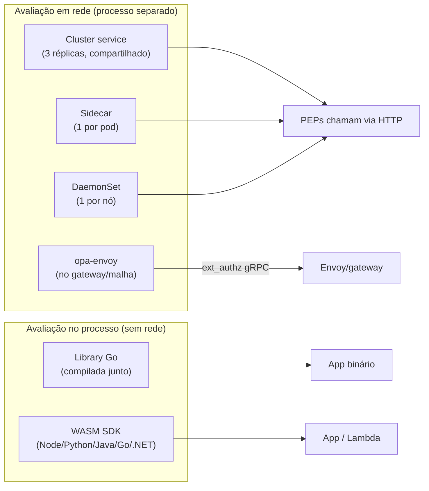

# Capítulo 9 — Modos de deploy do OPA: o espectro completo

> O curso usou dois modos (sidecar e cluster service) porque cobrem o caso MCP/EKS — mas o OPA é um motor genérico com um **espectro inteiro** de hospedagem: do processo colado no pod até a política **compilada e embutida dentro da sua aplicação** (WASM). Este capítulo mapeia todos, com critérios de escolha — e esclarece onde o Gatekeeper (que as pessoas chamam de "o operator do OPA") entra na história.

## 🎯 Objetivos

- Mapear o **espectro de hospedagem** do PDP: onde o processo/avaliação pode morar;
- Comparar os modos Kubernetes: **sidecar, cluster service, DaemonSet, opa-envoy**;
- Entender a modalidade **embutida**: library Go e **WASM SDK** (e por que WASM é a resposta para Lambda);
- Situar o **Gatekeeper** (admission control) e os legados (kube-mgmt);
- Escolher o modo por cenário AWS: EKS, ECS/Fargate, Lambda, EC2.

## 📖 Conteúdo

### 9.1 O espectro: da rede ao processo

Onde a avaliação acontece define latência, escala de atualização e blast radius ([docs — integration](https://openpolicyagent.org/docs/integration)):



A regra que organiza tudo: **quanto mais perto da decisão, menor a latência e maior o fan-out de atualização de política** — trade-off central da escolha.

### 9.2 Modos Kubernetes — os que você já conhece (resumo executivo)

| | **Sidecar** (cap. 5/6) | **Cluster service** (cap. 5) |
|---|---|---|
| Latência | localhost (~µs) | hop de rede (~ms) |
| Política | pode ser por pod (bundle próprio) | comum a todos |
| Recursos | multiplica por pod | 3 réplicas atendem todos |
| Falha | contida no pod | dependência central (mitigar: réplicas + HPA) |
| Melhor para | cada MCP com política própria; latência crítica | muitos PEPs, política comum, dados grandes |

### 9.3 DaemonSet (o modo que quase ninguém deve usar)

Um OPA **por nó**, compartilhado pelos pods daquele nó ([docs — deploy K8s](https://openpolicyagent.org/docs/deploy/k8s)). As docs oficiais são francas: **desencorajado** — escala mal (réplicas = nós, não carga), alocação de recursos delicada, e um nó sobrecarregado contamina todos os seus pods. Justificável apenas em clusters com poucos pods por nó e política estritamente por nó — um nicho. Se você viu DaemonSet em blog antigo, provavelmente era isso ou o kube-mgmt (seção 9.8).

### 9.4 opa-envoy-plugin: o OPA no data path do gateway

O plugin troca o servidor REST do OPA pela API **gRPC de autorização externa do Envoy** (`ext_authz`) — o Envoy (Istio, APP Gateway Controller, Emissary...) chama o OPA **antes de a requisição chegar à aplicação** ([opa-envoy-plugin no GitHub](https://github.com/open-policy-agent/opa-envoy-plugin)):

```yaml
# o OPA sobe com o plugin habilitado (imagem própria):
# docker://openpolicyagent/opa-envoy:...
decision: o OPA recebe o request HTTP inteiro do Envoy como input
```

- **Maior vantagem:** PEP = rede. A aplicação (o MCP!) **não tem código de autorização** — ela nem sabe que existe política;
- **Custo:** política expressa sobre o request HTTP (path, headers, JWT, body) — os **argumentos da ferramenta MCP** viajam no corpo JSON-RPC, então a política precisa parseá-los (dá, e é comum: `json.unmarshal` do body);
- **Quando escolher:** já existe malha/gateway na frente dos MCPs, ou você quer autorização de múltiplos times sem tocá-los.

### 9.5 Library Go: o OPA compilado dentro do seu binário

O OPA **é uma library Go** antes de ser um binário — é assim que o próprio Gatekeeper funciona (seção 9.7): ele importa o motor e avalia **no processo**, sem rede nenhuma:

```go
import "github.com/open-policy-agent/opa/rego"

query, _ := rego.New(
    rego.Query("data.mcp.autorizacao.decisao"),
    rego.Load([]string{"./policies"}, nil),
).PrepareForEval(ctx)

rs, _ := query.Eval(ctx, rego.EvalInput(input))
```

Atualização de política = carregar módulos novos e trocar o `PreparedQuery` (quente). Zero latência de rede e zero dependência externa — em troca, você só tem esse superpoder **em Go**, e cada processo precisa gerenciar seus bundles. Padrão para plataformas críticas escritas em Go (gateways, admission controllers).

### 9.6 WASM SDK: política embutida em qualquer linguagem (e o caso Lambda)

Para quem não é Go, o OPA **compila a política para WebAssembly** e os SDKs (`opa-wasm` para Node, Python, Java, Go, .NET/Rust) avaliam o módulo **dentro do processo** ([docs — WASM](https://www.openpolicyagent.org/docs/latest/wasm/)). O build do curso, validado com OPA 1.21:

```bash
# compila a política para WASM, com entrypoint na decisão do MCP:
opa build -t wasm \
  -e mcp/autorizacao/decisao \
  policies data/data.json \
  -o mcp-policy.wasm.tar.gz

# o bundle contém: /policy.wasm, /data.json, /.manifest
# a aplicação carrega o .wasm + data e avalia:
```

```javascript
// Node — avaliação in-process, ~microssegundos, sem servidor OPA
const { loadPolicy } = require('@open-policy-agent/opa-wasm');
const policy = await loadPolicy(await bundle('policy.wasm'));
const decisao = policy.evaluate({ input })[0]?.result;
```

**Trade-off honesto:** o módulo WASM carrega `data` **estático** — dados dinâmicos (papéis mudando) exigem recarregar/atualizar o contexto via `setData()`, orquestrado por você. Por isso WASM brilha em **política** estável + **contexto pequeno**, não em RBAC com base de dados grande.

**O caso Lambda:** não há como rodar um servidor OPA permanente colado numa Lambda — e chamar um OPA central a cada invocação adiciona hop e custo. O padrão AWS é compilar a política para WASM e **avaliar dentro da própria Lambda** (a camada/bundle deployado junto com o código). Atualizar política = publicar nova versão da Lambda com o `.wasm` novo.

### 9.7 Gatekeeper: o "operator" do OPA (para admission control)

Quando as pessoas dizem "operator do OPA", quase sempre querem dizer **Gatekeeper** — o projeto oficial (CNCF, time OPA) para **Kubernetes admission control**: políticas que validam/rejeitam **qualquer recurso entrando no cluster** (deployments sem limits, imagens fora do registry, namespaces sem label...). Ele embute o motor OPA (library Go, seção 9.5) num webhook de admissão e adiciona:

- **CRDs de política** — `ConstraintTemplate` (Rego parametrizável) e `Constraint` (instância com parâmetros);
- **Audit** — re-avalia recursos existentes e reporta violações;
- **Sync de dados do cluster** — injeta inventário (namespaces, etc.) no `data` das políticas.

**Não é o caminho para a missão deste curso** — admission control é *outra* fronteira (o cluster, não a aplicação) — mas se um dia a empresa quiser governança de manifests no EKS (ex.: todo Deployment dos MCPs precisa do sidecar OPA e do Pod Identity), Gatekeeper é a ferramenta, e você já sabe 90% (Rego).

### 9.8 Legados que você vai encontrar em blogs antigos

- **kube-mgmt** (Styra) — sidecar que sincronizava políticas de **ConfigMaps** para um OPA "cru" fazer admission. **Descontinuado**; o caminho oficial virou Gatekeeper. Não use em projeto novo;
- **OPA como DaemonSet "porque sim"** — padrão de tutoriais antigos, caiu em desuso (seção 9.3).

### 9.9 AWS além do EKS

| Ambiente | Modo recomendado | Nota |
|---|---|---|
| **EKS** | Sidecar (por MCP) ou cluster service (compartilhado) | Capítulos 5–6 |
| **ECS/Fargate** | Sidecar no mesmo task definition (`localhost`) | Mesma mecânica; a AWS publica o padrão em blog oficial |
| **Lambda** | **WASM embutido** na função | Seção 9.6; política = nova versão da função |
| **EC2/containers diretos** | OPA como systemd service/container local ao app | O binário Go é estático (`opa run --server`) |
| **Malha/gateway já existente** | opa-envoy (`ext_authz`) | Seção 9.4 |

Em todos: bundles de um S3 (ou registry) e decision logs para o CloudWatch — a operação do capítulo 7 não muda com o modo de deploy.

### 9.10 A tabela de decisão consolidada

| Critério → | Sidecar | Cluster svc | DaemonSet | opa-envoy | Library Go | WASM |
|---|---|---|---|---|---|---|
| Latência | µs (localhost) | ms (rede) | ms (nó) | ms (rede interna) | **µs (in-proc)** | **µs (in-proc)** |
| Política atualiza sem redeploy | ✅ (bundle) | ✅ (bundle) | ✅ | ✅ | ✅ (código gerencia) | ⚠️ (republicar artefato) |
| Dados grandes/dinâmicos | ok (bundle) | **melhor** (cache central) | ok | ok | ok | **pior** (setData manual) |
| App muda para adotar | pouco (client HTTP) | pouco | pouco | **zero** | só Go | SDK por linguagem |
| Falha do PDP | contida no pod | central | por nó | no gateway | impossível (in-proc) | impossível (in-proc) |
| Custo de recursos | por pod | 3 réplicas | por nó | por gateway | zero extra | zero extra |
| Casa para | MCPs no EKS | frota de PEPs | quase nunca | malha/gateway | plataformas Go | **Lambda**, apps não-Go |

Para os MCPs de vocês, a recomendação do curso se mantém: **sidecar no EKS como padrão, cluster service quando a frota crescer, opa-envoy se um gateway comum se impor, WASM quando uma política precisar rodar em Lambda**.

## 🧪 Laboratório 9 — Você já operou dois; agora compile o terceiro

1. **WASM na prática** (comando validado no OPA 1.21):

   ```bash
   opa build -t wasm -e mcp/autorizacao/decisao policies data/data.json \
     -o /tmp/mcp-policy.wasm.tar.gz
   tar -tzf /tmp/mcp-policy.wasm.tar.gz        # confira policy.wasm + data.json + manifest
   ```

   (Opcional, se tiver Node: `npm i @open-policy-agent/opa-wasm`, carregue o bundle e avalie o input do `exemplos/inputs/` — o resultado deve bater com o `opa eval` do capítulo 3;)

2. **Gatekeeper em 15 minutos** (só para ver o "operator"): num cluster de lab, `helm install gatekeeper gatekeeper/gatekeeper` e aplique um `ConstraintTemplate` que exija a label `team` em namespaces — perceba que o corpo Rego é o mesmo Rego do curso, embrulhado em CRD;
3. **Exercício de arquitetura** (responda antes de olhar a seção 9.10):
   - Um MCP em Lambda que valida ferramentas → qual modo? Por quê?
   - 12 microservizes polyglotta no EKS, mesma organização de políticas, times diferentes → qual?
   - Istio já implantado na empresa, time de app resiste a mudar código → qual?
4. **Verificação:** suas respostas devem ter sido WASM, cluster service e opa-envoy — com as justificativas de latência/atualização/adoção que a tabela consolida.

## Próximos passos

- Isto fecha a extensão do curso (caps. 8–9). O caminho de continuação segue no [capítulo 7](cap-07-operacao.md): operar o que você desenhar;
- Dúvidas de escolha de modo para um caso real da empresa? Descreva o cenário ao agente — a tabela 9.10 existe justamente para esse debate.

## 📚 Fontes

- [OPA — Deploy no Kubernetes (todos os modos)](https://openpolicyagent.org/docs/deploy/k8s)
- [OPA — Integrating OPA (REST, Go library, sidecar)](https://openpolicyagent.org/docs/integration)
- [OPA — WASM](https://www.openpolicyagent.org/docs/latest/wasm/)
- [opa-envoy-plugin (GitHub)](https://github.com/open-policy-agent/opa-envoy-plugin)
- [Gatekeeper (projeto oficial)](https://open-policy-agent.github.io/gatekeeper/website/)
- [OPA — Ecosystem (integrações: Kafka etc.)](https://openpolicyagent.org/ecosystem)
